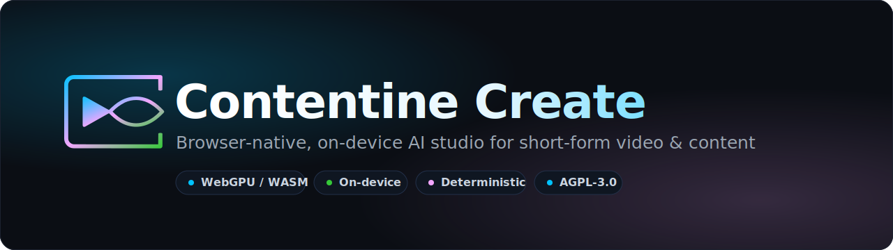
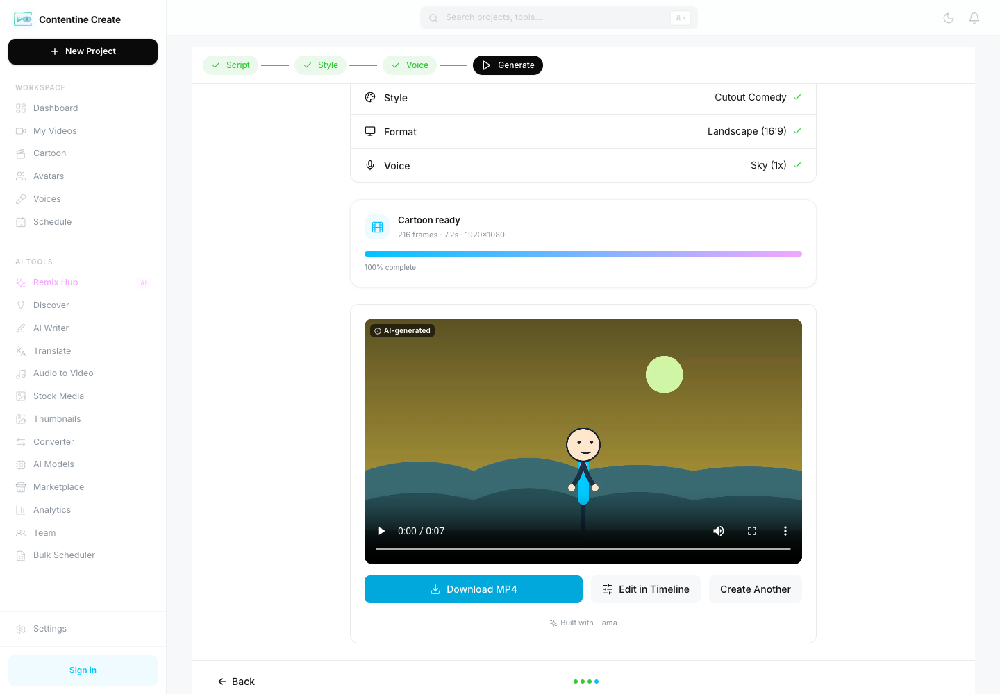
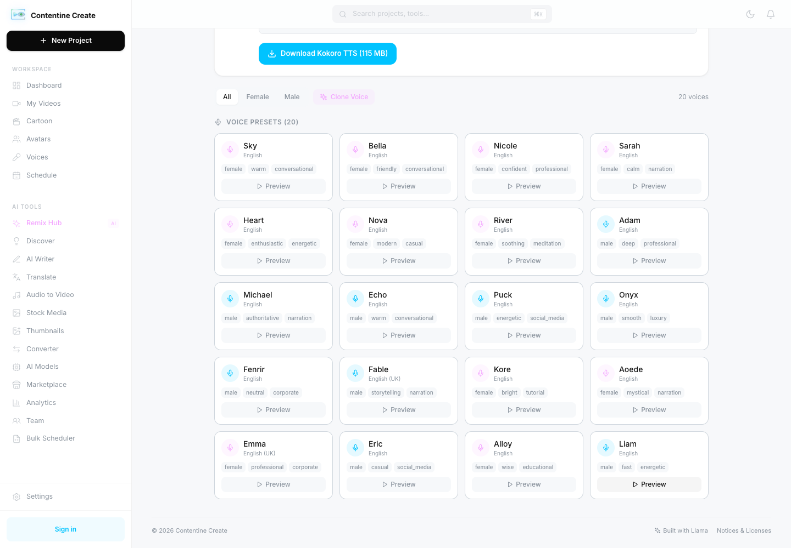
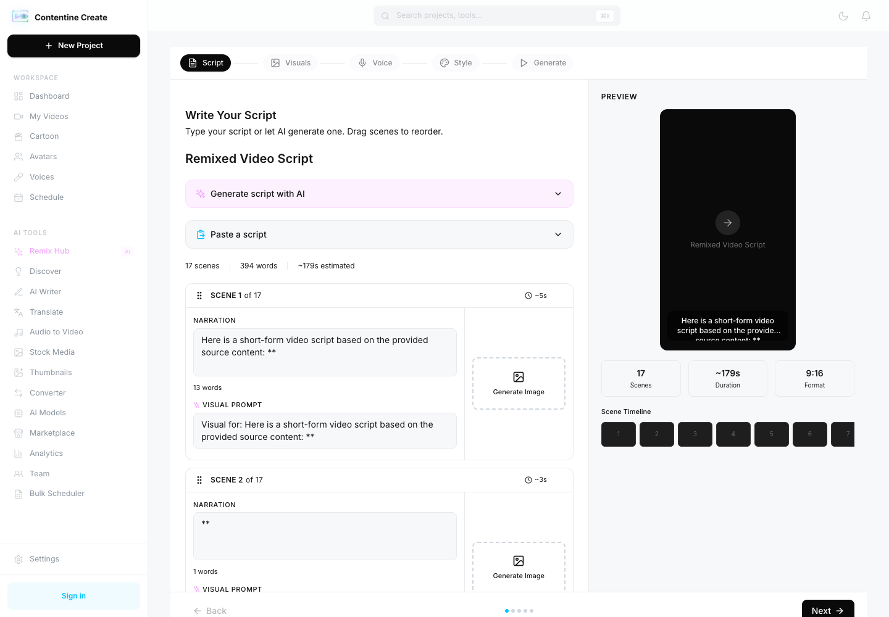

<div align="center">



<br/>

[](ROADMAP.md)
[](LICENSE)
[](../../actions)
[](../../stargazers)
[](../../commits/main)
[](CONTRIBUTING.md)

[](https://nextjs.org)
[](https://developer.mozilla.org/docs/Web/API/WebGPU_API)
[](https://php.net)

**Generate scripts, voices, avatars, and animated video — in the browser, on your own device, with no server GPU.**

[Quick start](#quick-start) · [What works today](#what-works-today) · [Deploy](DEPLOYMENT.md) · [Roadmap](ROADMAP.md) · [Contributing](CONTRIBUTING.md)

</div>

---

> **⭐ If you'd use a tool like this, a star helps it find collaborators.** Contentine Create is a **working prototype** built largely by one developer, now open source because it deserves a team. Several core flows are proven end-to-end (real, playable MP4s); one headline flow is gated on a licensing decision; and there's plenty of high-value work left. If that's your kind of project, see [Looking for collaborators](#looking-for-collaborators).

## What it is

Contentine Create turns an idea, a script, or a URL into finished short-form content **without sending your media to a server**. The heavy AI runs in your browser on WebGPU (with a WASM fallback): text-to-speech, speech-to-text, small language models for scripting, talking-head avatars, and a deterministic cartoon/motion-graphics renderer. An **optional** PHP/MySQL backend handles sign-in, credits, and commerce — but it is never required to *create*.

- **On-device by default.** Your script, your voice recording, your render — none of it needs to leave the machine. No server GPU bill; works offline after the models are cached.
- **Deterministic rendering.** Video is rendered frame-accurately (`seek()` per frame → `OffscreenCanvas` → `WebCodecs` → [Mediabunny](https://github.com/Vanilagy/mediabunny)), not screen-captured. The same project file produces the same output on any device.
- **License-disciplined.** Every shipped model's **weights** license is read and recorded in [`NOTICE`](NOTICE) / [`LICENSES.md`](LICENSES.md). Anything with unmet obligations ships behind a feature flag that defaults to **off**.

## See it in action

<div align="center">

<br/>
<sub>A cartoon scene rendered <b>entirely in the browser</b> — 216 frames, 1920×1080, downloadable MP4. No server GPU touched it.</sub>
</div>

<br/>

<table>
<tr>
<td width="50%" valign="top">

<br/><sub><b>20 on-device voices</b> (Kokoro TTS) — preview instantly, clone your own with recorded consent.</sub>
</td>
<td width="50%" valign="top">

<br/><sub><b>Script → Visuals → Voice → Style → Generate</b> — a URL becomes a scene-by-scene video script.</sub>
</td>
</tr>
</table>

## What works today

A flow counts as "working" only if it produces a **downloaded, ffprobe-valid MP4** — never a green spinner.

| Flow | Status |
|---|:--|
| Avatar (talking head) → MP4 | ✅ **Proven** |
| Audio-to-video (upload audio → on-device transcription → captioned video) → MP4 | ✅ **Proven** |
| Cartoon (script → styled animated scene → render) → MP4 | ✅ **Proven** |
| Cartoon projects: save, reopen after a browser restart, back up/restore (`.ccproj`) | ✅ **Proven** — [evidence A05/A06](docs/execution/EVIDENCE.md) |
| Cartoon scene edit by an AI assistant over MCP (inspect → patch → render → save) | ✅ **Proven** with Claude Code on Chrome — [evidence A12](docs/execution/EVIDENCE.md), [bridge](bridge/README.md) |
| Script generation (on-device SLM, with honest fallbacks) | ✅ **Proven** |
| URL → extract → script → video **wizard** | ✅ Up to the visuals step |
| URL → **video** (AI images) → MP4 | ⚠️ Gated on a model-license decision — see [ROADMAP](ROADMAP.md) |

## Quick start

| Requirement | Minimum | Notes |
|---|---|---|
| Node | 18+ | for the frontend app |
| Browser | recent Chrome / Edge | WebGPU for the fast path; WASM fallback otherwise |
| PHP + MySQL/MariaDB | PHP 8.0+ | **optional** — only for sign-in, credits, and sync |

```bash
git clone https://github.com/BeyondITL/contentine-create.git
cd contentine-create

# Frontend — the app itself
cd frontend && npm install && cd ..
bash scripts/setup-assets.sh      # downloads the open model weights the app uses
cd frontend && npm run dev        # → http://localhost:3000
```

The app runs **frontend-only** out of the box. To enable sign-in, credits, and sync, set up the optional backend: copy `admin_config.php.template` → `admin_config.php` (kept out of git; **never commit real secrets**) and run `cd backend && composer install`.

## Project layout

```
frontend/      Next.js 14 static-export app — the engines, UI, and Zustand stores
backend/       Optional PHP 8 API (auth sync, credits, commerce). PSR-4, no framework
database/      SQL schema + ordered migrations
bridge/        Local MCP companion that lets an AI assistant drive a paired Cartoon Studio tab
samples/       Versioned sample projects (cartoon scene plans)
scripts/       Asset setup, model manifest/BOM checks, and verification harnesses
docs/          Engineering, UI/UX, and implementation specs (cartoon: architecture, commands, project format)
.claude/       Claude Code project config: laws, hooks, subagents, and domain skills
```

## Architecture

- **Frontend:** Next.js 14 static export (`output: 'export'`, no SSR) — every engine import is dynamic. State in [Zustand](https://github.com/pmndrs/zustand) stores; IndexedDB/OPFS as the primary data layer.
- **Engines:** Kokoro TTS (voices), Whisper/Moonshine (ASR + captions), WebLLM small language models (scripting), TalkingHead + three.js (avatars), a GSAP-timeline cartoon engine — all exporting through WebCodecs + Mediabunny in a Worker.
- **Backend (optional):** PHP 8 front-controller (`backend/public/index.php`), PSR-4 `Contentine\` namespace, MySQL. Non-blocking sync/commerce only.

Full detail: [`ARCHITECTURE.md`](ARCHITECTURE.md) and [`docs/ENGINEERING_SPEC.md`](docs/ENGINEERING_SPEC.md).

## Deployment

It's a static frontend (`frontend/out/`) plus an optional PHP backend, so it deploys on almost anything — shared host, VPS, container, or a static CDN paired with any PHP host. See **[DEPLOYMENT.md](DEPLOYMENT.md)** for the full, vendor-neutral guide, with ready-to-edit configs for Apache (`.htaccess`), [Nginx](deploy/nginx.conf.example), and [IIS](deploy/web.config.example). The one hard requirement is cross-origin isolation (`COOP: same-origin` + `COEP: require-corp`) for the in-browser engines.

## Models & licenses

Contentine Create orchestrates third-party open models but **does not redistribute their weights** — `scripts/setup-assets.sh` downloads them from their official sources. Each model's license, obligations, and status are recorded in [`NOTICE`](NOTICE) and [`LICENSES.md`](LICENSES.md). Notably, SD-Turbo image generation ships **disabled by default** pending acceptance of the Stability AI Community License (attribution + the US$1M revenue cliff). Read `NOTICE` before enabling any gated model.

## Looking for collaborators

The honest ask: **one developer can't take this to a market-grade product alone.** If you care about on-device AI, WebGPU, TTS/ASR, deterministic rendering — or just want to help a real codebase grow — you're very welcome here.

Good places to start:

- Issues labeled [`good first issue`](../../labels/good%20first%20issue) and [`help wanted`](../../labels/help%20wanted).
- The open items in [ROADMAP.md](ROADMAP.md) — the URL→video visuals story, the script-parser hardening, and accessibility are all well-scoped.
- [CONTRIBUTING.md](CONTRIBUTING.md) — dev setup, the "no facades / evidence before done" bar, and the [graphify](https://github.com/Graphify-Labs/graphify) knowledge-graph tooling this repo uses.

## License

Code is licensed under **[AGPL-3.0](LICENSE)** — use, modify, and self-host freely, but if you run a modified version as a network service, you must publish your source. Third-party model weights keep their own licenses (see [`NOTICE`](NOTICE)). Contributions are accepted under the [Contributor License Agreement](CLA.md).

---

<div align="center">
<sub>Built by <a href="https://github.com/BeyondITL">BeyondITL</a> · part of the Contentine project.</sub>
</div>
